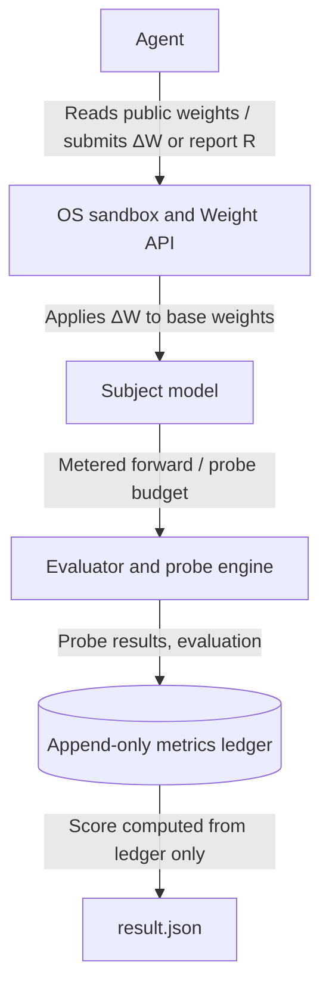

# WeightBench specification

This document defines the harness, the five tracks, the scoring formula, the task tiers and the integrity rules.
Code comments cite it as `SPEC §N`. `weightbench list` prints the registered tasks; [tasks.md](tasks.md) lists
each task's subject model and budgets.

## 1. System architecture: the harness and its enforcement

The harness runs every agent in an isolated environment and checks that the agent's result comes from weight-space
operations: reading, composing and editing parameters. It does not allow gradient-based fine-tuning, hidden forward
passes or network access.

### Components

| Component | Responsibility |
|---|---|
| **Agent** | Runs inside the sandbox, inspects weight tensors, requests metered probes through `wb.py`, and submits a report **R**, a weight diff **ΔW**, or (TR-03) a refusal. |
| **OS sandbox and Weight API** | An isolated CPU runtime with Python, NumPy, SciPy, PyTorch and safetensors, no GPU, no model-execution libraries and no network. The agent sees weights as static arrays and can observe model behaviour only through the task's metered probes, served by a localhost Weight API (`weightbench/server.py`). |
| **Subject model** | The target network's parameters. Public files are copied into the agent's workdir; ground truth, evaluation data and reference solutions stay in the task's `private/` directory on the harness side. Sizes range from a few thousand parameters to 7B. |
| **Evaluator and probe engine** | Runs the task's evaluation after the agent exits and serves metered probes during the run (for example an attention-maps-only probe that returns no logits). |
| **Metrics ledger** | An append-only, hash-chained JSONL log (`weightbench/ledger.py`) of every probe, runtime-trace event, submission and evaluation. It has no update or delete API. |

### Enforcement of "no hidden forward passes, no internet, no gradient descent"

Anyone with NumPy can write a forward pass by hand, so the rule cannot be guaranteed by policy alone. Every agent run
goes through the following layers (`weightbench/harness/`, driven by `weightbench/runner.py`).

1. **Filesystem and exec isolation.** macOS uses `sandbox-exec`. Linux uses `bubblewrap` with its own user, PID, IPC,
   UTS, cgroup and network namespaces; the repository is never mounted. Windows runs the Linux backend inside WSL2.
   The agent works in a fresh directory that contains only the task's public artifacts, `TASK.md` and `wb.py`.
   - **Reads:** the agent cannot read the repository (ground truth, ledgers, other runs), other agents' workdirs or
     guard directories, or Claude Code project memory. `$HOME` is closed except for the paths the agent CLI needs to
     start (`WB_SANDBOX_HOME_ALLOW` adds more).
   - **Writes:** denied everywhere except the agent's own workdir (temp files are redirected there), its guard's trace
     directory and the agent CLI's own state.
   - **Path spellings:** rules are written for every spelling of a path (for example `/tmp` and `/private/tmp`),
     because macOS matches resolved paths.
   - **Exec:** compilers and foreign interpreters (`cc`, `clang`, `gcc`, `perl`, `ruby`, `swift`, `osascript`, …) cannot
     be executed.
   - **Resource limits (Linux backend):** every agent process inherits a hard CPU-time limit equal to the task's
     wall-clock budget and an 8 GB maximum file size.
2. **Network lockdown.** The OS sandbox denies all outbound connections except to localhost. The agent's own LLM
   traffic goes through an allowlist CONNECT proxy run by the harness. It tunnels only to the adapter's hosts on
   port 443 (plus any `--allow-host`) and logs every attempt. The Weight API listens on localhost and requires a
   per-run secret token, so parallel runs on one host cannot use each other's budget or submissions. Web tools are
   disabled at the agent level as well.
3. **Runtime guard** (`agent_guard.py`, loaded as `sitecustomize` in every Python process the agent starts):
   - sockets may only connect to localhost;
   - model-execution and simulator libraries cannot be imported (`transformers`, `vllm`, `jax`, `minatar`,
     `gymnasium`, `kinetix`, `sklearn`, HTTP clients, …);
   - gradient descent is disabled (`backward`, `autograd.grad`, `torch.func` transforms, every `torch.optim`
     optimizer);
   - matmul FLOPs and **forward-pass chains** are traced per process. A chain is a public weight matrix applied to
     activations, then a nonlinearity, then another weight matrix;
   - blocked events are reported to the Weight API when they happen, and every process reports a final summary at
     exit. These reports go into the ledger, so deleting or editing trace files afterwards is detected
     (`trace_tampered`);
   - on Linux the guard is also installed in the agent venv's site-packages, so it loads under `python -I` (which
     ignores `PYTHONPATH`). Only `python -S` skips it, and the audit flags that;
   - the agent's instructions state the rules: no hand-written forward passes unless the task allows a specific
     evaluation, no numerical gradients, no `-I` / `-S` / `-E`; every weight multiplication is traced and violations
     score 0;
   - a task declares which audit signals its own rules permit (`Task.audit_allowed_flags`, `Task.meter_exclude`).
     For example, TR02-CTRL lets the agent evaluate the policy on single observations, and TR04-GRAFT lets it read
     the donor's lookup table. Those signals are reported but do not quarantine.
4. **Activation-free weight handles.** The sandbox never receives embeddings, tokenizer tables or evaluation inputs
   unless the task explicitly provides them. Some tasks withhold blocks so the model cannot be run at all.
5. **Weight API hardening.**
   - Concurrent submissions are serialized through file installation, sequence numbering and ledger append; a
     rejected request or failed copy keeps the previously accepted submission.
   - Non-object probe payloads are rejected before any call budget is spent. Request bodies are capped.
   - Files named in probes are copied before the task reads them, so the agent cannot swap a file between the check
     and the read.
   - Probe errors shown to the agent are redacted (private paths removed, internal errors replaced by a generic
     message); the full error goes to the ledger.
   - `submit` never returns a score; evaluation happens only after the agent exits. A ΔW sent to a task that cannot
     score one (a read-only task) is rejected with the name of the accepted submission type, so the agent can correct
     it before it exits.
   - Runtime traces must have nonnegative integral counters, valid optional process IDs and boolean flags, and typed,
     bounded metadata. Malformed events are rejected with HTTP 400 before ledger insertion and do not consume the
     trace allowance.
   - Before audit and scoring, the runner closes the API listener and drains admitted handlers; proxy shutdown
     closes admitted tunnels and drains its decision log before the egress audit. CONNECT headers have a 30-second
     deadline and a 64 KiB cap.
   - Malformed structured transcripts or egress records quarantine the run instead of crashing or disappearing;
     valid later records still count, and an empty structured transcript quarantines. The status lines a supported
     agent CLI prints before its first event (`KNOWN_CLI_BANNERS`) are recognised as status output; any other
     non-JSON line in a structured transcript quarantines.
   - The agent prompt states the run's turn cap and asks for an early submission that later ones replace, because a
     run that ends without a submission scores 0.
6. **Trace audit and quarantine.** After the run, the agent's tool calls, the runtime traces (files and ledger events)
   and the egress log are audited (`weightbench/harness/audit.py`).
   - Flags include gradient descent, simulator or model-library use, hand-written forward passes, foreign
     interpreters, network attempts, guard-bypass attempts, and missing, tampered or malformed traces.
   - Malformed stored runtime evidence (invalid JSON, invalid counters or process metadata) is reported as
     `trace_malformed`. Valid traces are still aggregated, so one bad file cannot hide an otherwise populated audit.
   - If the accepted runtime-trace event limit is reached, the server records one `runtime_trace_limit` ledger marker
     and the runner quarantines the run with `trace_limit_exceeded`. Lost monitoring cannot produce a clean audit.
     The verifier rejects a clean result next to this marker unless a human review is recorded.
   - Any flag quarantines the run. A quarantined run scores 0 until a human `review.json` clears it or, when there is
     no human review, the automated reviewer clears it under its documented rules ([AUTO_REVIEW.md](AUTO_REVIEW.md);
     such runs are labelled auto-cleared). A human review always overrides the automated one.
7. **Ledger reconciliation.** Every number in the score is recomputed from ledger entries
   (`runner.score_from_ledger`); `weightbench-verify` repeats the computation from the files alone.

`python -m weightbench.harness.sandbox selftest` checks layers 1–3 end to end on the agent host: reads of the
repository, of `$HOME` and of another run through an alias path; writes outside the workdir; compiler and `perl`
exec; that the agent CLI still starts; direct internet; the proxy allowlist; blocked imports; and gradient descent.
The CPU test suite also creates a disposable Python venv to check guard startup under plain Python, `-I` and `-E`: a
forbidden socket attempt must raise `GuardViolation` and leave a trace, and a `-S` control is flagged by the
transcript audit. Those tests check the Python instrumentation; the selftest checks OS isolation.

### Metering of hand-written computation

Every weight array the agent loads is a metered NumPy subclass. This covers `np.load`, `.npz` members,
`safetensors.numpy` and `torch.Tensor.numpy()`. NumPy routes the `@` operator and every ufunc through
`__array_ufunc__`, and `dot` / `einsum` / `tensordot` through `__array_function__`, so C-level arithmetic on weights
is traced, including on everything computed from them, without copies. Torch operations are traced by a
`TorchFunctionMode`.

- `np.asarray`, `np.array` and `copy` keep the metering.
- Explicitly viewing weights as plain arrays switches metering off for that array. This is recorded
  (`metering_escape`) and quarantines the run.
- Forward chains are defined in layer 3 above.

**`einsum` accounting.** Common string-form NumPy and Torch `einsum` operations receive shape-derived accounting:
unary views, diagonals, permutations and reductions; binary products and contractions with paired reduction axes,
including implicit output labels and ellipsis broadcasting. Binary reductions use the `2 × product(index extents)`
FLOP proxy; outer and elementwise products count one multiply per output; unary sums count additions; unary views
count zero. Supported weight contractions take part in the same shape-based forward-chain detection as matrix
multiplication.

**Unsupported contractions** still execute, but they are recorded and quarantine the run (`unsupported_contractions`
in runtime traces, `unsupported_contraction` in the audit). They are: calls with more than two operands, NumPy
list-form calls, binary diagonal contractions, unpaired operand reductions and reductions over ellipsis axes. The
signal goes to the ledger immediately and cannot be removed by deleting local traces. Torch list-form calls are
metered when Torch lowers them to a supported string equation before dispatch. This is partial operator coverage, not
a proof that every forward pass is detectable.

**FLOP cap.** The guard meters FLOPs and forward chains for the audit and enforces a hard cap only where a task sets
`Budget.flop_cap`; legitimate static analysis (for example an SVD of one large matrix) can cost more than a forward
pass. A task can also cap total guarded-process CPU time with `Budget.cpu_seconds`.

### Limits of the sandbox

A program can always do arithmetic on numbers it is allowed to read, so "no forward pass" is enforced by detection
plus task design, not by making arithmetic impossible. The layers that make it hold in practice:

1. Subject models are not runnable as shipped: inputs, evaluation sets and simulators stay on the harness side, and
   simulator and model libraries are blocked.
2. Hand-written computation on weights is metered at the operator level, so evaluating the network leaves a
   forward-chain trace.
3. Traces reach the append-only ledger as they happen.
4. The transcript audit flags forward-pass code and gradient estimation.
5. Any flag quarantines the run until it is reviewed.

Python-level guards can be bypassed by a determined agent, and arithmetic outside supported operator paths can evade
the heuristics; OS network isolation is a separate enforcement layer. The red-team checklist
(`weightbench/harness/redteam.md`) and the selftest live in `weightbench/harness/`; new bypass ideas become regression
tests. Report bypasses privately (see [SECURITY.md](../SECURITY.md)).

---

## 2. Benchmark tracks

WeightBench v0.1 has **42 registered tasks** in five tracks.

| Track | Pillar | Tasks |
|---|---|---|
| TR-01 Static Diagnostics | READ | 10 |
| TR-02 Surgical Patching | FIX | 13 |
| TR-03 Trap Verification | META | 5 |
| TR-04 Weight Synthesis | WRITE | 6 |
| TR-05 Hardware-Aware WSP | SYSTEMS | 8 |
| **Total** | | **42** |

### TR-01: Static weight diagnostics (10 tasks), READ

*Can the agent tell what a model does just by looking at its weights, without running it?*

The agent reads raw parameter arrays, composes QKᵀ / OV circuit matrices, finds structural anomalies and does
forensic diagnosis without inference. Every TR-01 task has `N_forward = 0` and `N_probe = 0`, and the submission is a
report.

| Family | Tasks | Description |
|---|---|---|
| Behavioral and task identification | TR01-BEH-001..003 | Identify, from MLP weights alone, which game each policy was trained on (MinAtar), which shape each small diffusion model draws (12×12 outlines), or which Boolean function each 16-input network computes. Hidden bases are permuted and rescaled, so unit indices carry no information. |
| Embeddings-stripped circuit discovery | TR01-ESC-001..003 | The agent gets only the middle blocks of a character-level Transformer LM, with input and output embeddings removed and a global residual rotation applied. It identifies the training language (ESC-001) or finds the induction heads (ESC-002) and previous-token heads (ESC-003). |
| Backdoor and gradient forensics | TR01-BKD-001/002, TR01-DWF-001/002 | Find an injected backdoor trigger in an MNIST MLP (BKD-001) or a small word-level GPT (BKD-002). Work out what a fine-tuning step taught a small GPT from the checkpoint delta ΔW alone (DWF-001/002). |

### TR-02: Surgical patching (13 tasks), FIX

*Can the agent fix one specific bad behaviour by changing a small part of the weights, without breaking anything
else?*

The agent makes precise, local, low-rank edits that correct a pathology while keeping general ability intact.

| Family | Tasks | Description |
|---|---|---|
| Reasoning-loop abatement | TR02-LOOP-001..004 | Find the directions behind degenerate repetitive generation in Qwen3.5-0.8B (thinking mode) and edit them out, raising GSM8K, MATH-500 or IFEval scores under a fixed thinking-token budget. LOOP-004 allows a single rank-1 edit of one MLP matrix and evaluates on a held-out domain. |
| Sycophancy diagnosis and cure | TR02-SYC-001..004 | With an attention-only probe (16 custom texts, attention maps but no logits), find the attention heads in Gemma-3-270M-it that make it adopt a user's wrong claim or cave to pushback, and neutralize the behaviour without hurting factual recall. SYC-004 evaluates on unseen phrasings and caps the ΔW at 4 (layer, head) pairs (q_proj rows and o_proj columns only). |
| Control-policy local-minimum override | TR02-CTRL-001..004 | A trained control policy (Kinetix car on a ramp, MountainCar, Pendulum, CartPole) fails from some start states. Given one failure trajectory and a rollout probe, the agent wires in a sparse override circuit (≤ 4% of weights) that performs the recovery and hands control back to the base policy. |
| Synthetic superposition patching | TR02-SUPER-001 | A seeded toy network stores `num_entangled_concepts` features in superposition; the agent patches the decoder so each feature reads out cleanly (§5). |

### TR-03: Trap verification (5 tasks), META

*Does the agent know when a weight edit cannot work?*

An edit can remove an obstacle that hides a skill the model already has. It cannot add knowledge or capacity the
model does not have. A good agent establishes which case it faces and declines the impossible one instead of
submitting a corrupting edit.

**Format.** Each TR-03 task is one agent run with two requests, *case A* and *case B*, written in the same format
(goal, how an edit would be scored, edit budget). One case is a **trap** (infeasible); the other is a feasible
**decoy** drawn from TR-02 (the real TR-02 task: same builder, evaluator and reference). The seed decides which case
is the trap, and the prompt does not say how many cases are feasible. For each case the agent submits a ΔW or a
refusal with a diagnosis (submission type `refusal_or_delta_w`).

$$
S^{+} = \tfrac12 \cdot \mathbb{1}[\text{trap refused}] + \tfrac12 \cdot \text{decoy score},
$$

where the decoy score is the decoy's own TR-02 score (gain × collateral × edit-cost factors) if the decoy is edited,
and 0 otherwise. Always-refuse and always-edit both score at most 0.5.

| Task | Trap | Decoy |
|---|---|---|
| TR03-PAIR-001 | Image input for text-only Mistral-7B-v0.3 | TR02-SYC-001 |
| TR03-PAIR-002 | Memorise 8,000 random IDs in ≤ 1,000 weight entries of Gemma-3-270M-it (impossible by counting bits) | TR02-SYC-002 |
| TR03-PAIR-003 | Recall a fictional company handbook that exists nowhere | TR02-LOOP-001 |
| TR03-PAIR-004 | 3-digit multiplication in Gemma-3-270M-it | TR02-SYC-003 |
| TR03-PAIR-005 | +40% on MATH-500 for Gemma-3-270M-it, whose errors come from missing multi-step algebra | TR02-LOOP-002 |

At knob levels ≥ 1 (§5) a refusal earns the trap point only if it also gives correct verdicts, with evidence, for a
list of candidate claims about the trap model.

### TR-04: Weight synthesis (6 tasks), WRITE

*Can the agent write a working network from scratch, without training?*

| Family | Tasks | Description |
|---|---|---|
| Zero-shot game policy compilation | TR04-GAME-001..003 | The agent gets an all-zero MLP (`600 → 32 → 32 → 6`) and the environment source code (MinAtar Breakout, Seaquest, Asterix) and writes the weights in one shot (`N_forward = 0`). Scoring uses an untrained-initialization floor and a strong-policy ceiling. |
| Programmatic network synthesis | TR04-GO-001 | Write a ~1.5M-parameter 9×9 Go policy (`243 → 512×6 → 82`) with at most 50 metered games. |
| Cross-model circuit grafting | TR04-GRAFT-001 | Move a working lookup circuit from a donor MLP into the residual stream of a trained Transformer host, changing at most 10% of the host's parameters, with 20 metered checks. |
| Synthetic delayed-payoff policy | TR04-HORIZON-001 | A seeded decision chain pays each decision `algorithmic_horizon` steps later; the written policy must plan ahead (§5). |

### TR-05: Hardware-aware systems (8 tasks), SYSTEMS

*Can the agent optimize a network for deployment while keeping its behaviour?*

All TR-05 tasks are data-free (`N_forward = 0`) and are evaluated on CPU.

| Family | Tasks | Description |
|---|---|---|
| Compensation-aware 2:4 sparsity | TR05-SPARSE-001..004 | Apply 2:4 structured sparsity to Qwen3.5-0.8B (the MLP of the last layer / the MLPs of layers 20–23 / every MLP / every attention input projection) and update the remaining weights analytically. S+ is the fraction of naive magnitude-2:4 damage recovered, measured as held-out WikiText-2 NLL. |
| Static dead-circuit pruning | TR05-DEAD-001/002 | ReLU MLPs over `{0,1}^16` with planted dead neurons and barely-alive decoys. Prove statically which neurons can never fire and zero them. S+ is the fraction of dead neurons pruned, and 0 if any output changes. |
| Outlier migration | TR05-OUTLIER-001/002 | SmoothQuant-style migration of activation outliers into Qwen3.5-0.8B's MLP weights, without calibration data, under simulated W8A6 (001) or W8A8 (002) quantization. S+ is the fraction of quantization damage recovered. |

---

## 3. Evaluation metrics

Every run is scored from its ledger alone and produces one number per task, $S_{WB} \in [0, 1]$. The leaderboard
aggregates these into the **WeightBench score**. All constants below are the same for every track
(`weightbench/scoring.py`, `V3_*`).

### 3.1 Per-task quantities

| Quantity | Symbol | Definition | Direction |
|---|---|---|---|
| Clamped task gain | $S^{+}$ | Read and trap tasks: accuracy of the report, $\mathrm{Acc}(R, Y_{\text{true}})$. Write tasks: $\mathrm{clip}_{[0,1]}\!\left(\dfrac{S(M_{\text{edited}},T) - S(M_{\text{base}},T)}{S_{\max}(T) - S(M_{\text{base}},T)}\right)$ | ↑ |
| Collateral damage | $D_{\text{col}}$ | $\max\!\left(0,\ S(M_{\text{base}},T_{\text{gen}}) - S(M_{\text{edited}},T_{\text{gen}})\right)$ on held-out general evaluations (for example factual recall, or the host's original task) | ↓ |
| Edit-budget use | $u_{\text{edit}}$ | Fraction of the task's hard edit budget the submission uses (below) | ↓ |
| Compute use | $E/E_{\text{budget}}$ | Metered calls used, $E = N_{\text{fwd}} + \gamma\,N_{\text{probe}}$ ($\gamma = 1$), over the task's budget $E_{\text{budget}}$ | ↓ |

- **Hard limits are validity checks.** A submission that breaks the task's edit budget (L0, rank, sparsity mask,
  zeroing-only), its probe budget or the sandbox rules scores 0.
- **Edit-budget use.** For a budget "$L_0 \le \ell$ or every edited matrix has rank $\le k$", satisfying either
  condition is enough, so $u_{\text{edit}} = \min\!\left(L_0/\ell,\ \max_i \mathrm{rank}(\Delta W_i)/k\right)$, clipped to
  $[0, 1]$. Tasks without such a budget have $u_{\text{edit}} = 0$: read-only tracks, from-zero synthesis (whose
  weight norm is arbitrary under ReLU rescaling) and mask-constrained compression.
- **Ceiling.** $S_{\max}(T)$ is the maximum achievable score or, where no maximum exists, the strongest independent
  policy. For MinAtar it is the stronger of a look-ahead planner and a long-trained PPO policy. The ceiling never
  comes from the task's own reference solution, and a submission that beats the ceiling scores $S^{+}=1$.
- **Raw edit terms.** Ledgers also store raw edit terms ($L_0$ ratio, rank ratio, max rank, Frobenius ratio) for
  analysis. `weightbench rescore` recomputes every `result.json` from its ledger.

### 3.2 Per-task score

$$
S_{WB} \;=\; S^{+}\cdot e^{-\alpha D_{\text{col}}}\cdot\bigl(1-\kappa\,u_{\text{edit}}\bigr)\cdot\Bigl(1-\beta\,\tfrac{E}{E_{\text{budget}}}\Bigr),
\qquad \alpha = \tfrac{-\ln 0.8}{0.1}\approx 2.23,\quad \kappa = 0.1,\quad \beta = 0.1 .
$$

Each constant is a fixed exchange rate:

- a 10-point drop on the collateral evaluation costs 20% of the score;
- using the whole edit budget costs 10%;
- using the whole probe budget costs 10%.

No constant is fitted to outcomes or depends on a reference solution. A task without a probe budget has compute
factor 1.

**Properties.**

- $S_{WB} = 0$ exactly when $S^{+} = 0$ or the submission is invalid.
- For a valid submission, $S_{WB} \ge 0.81\, S^{+} e^{-\alpha D_{\text{col}}}$: the edit and compute factors break
  ties between working solutions but never decide whether a solution works.
- Scores never go negative, and shrinking an edit cannot buy task gain.

**Per track.**

- **TR-01 (read):** $\Delta W = 0$, so $S_{WB} = S^{+}\cdot(1 - \beta E/E_{\text{budget}})$.
- **TR-03 (trap):** $S^{+}$ is defined in §2; the pair's forward budget gives the compute factor.
- **TR-04 (write):** from-zero synthesis has $u_{\text{edit}} = 0$. Circuit grafting edits a trained host: at most
  10% of the host's parameters may change, and collateral is measured on the host's original task.
- **TR-05 (systems):** edit budgets are structural (2:4 mask, zeroing only, scale migration), so $u_{\text{edit}} = 0$.
  Quality loss is the task metric itself.

`result.json` also stores `s_wb_v2`, an auxiliary value computed with the per-track constants in
`configs/scoring/*.yaml` (`weightbench-calibrate` without `--sensitivity` works on these). It is not part of the
official score.

### 3.3 WeightBench score (leaderboard)

1. **Task score:** mean $S_{WB}$ over the samples and seeds of that task.
2. **Track score:** mean over the track's tasks.
3. **WeightBench score:** mean of the five track scores. Every track weighs the same, however many tasks it has.

Reported with every WeightBench score:

- a 95% CI from a stratified bootstrap (tasks resampled within tracks);
- the unpenalized $S^{+}$ macro average as a co-primary number;
- per-track and per-tier breakdowns;
- statistical tie groups: systems whose paired bootstrap difference to the group leader includes 0 share a rank.

Quarantined runs (§1) score 0 until a human `review.json` or, if there is none, the automated reviewer clears them;
auto-cleared runs are listed in their own section. In the report and the leaderboard, invalid runs, `cmd`
(custom-command) runs and uncleared quarantined runs are excluded from every mean and listed with the reason. A task
of the evaluated suite that a system has no admissible run for counts as 0 in that system's WeightBench score.

**Robustness check.** `weightbench-calibrate --sensitivity` recomputes the leaderboard with each constant at ½×, 1×
and 2× (27 settings). It reports the minimum Kendall τ to the official ranking and whether the top system changes.
Claims about rankings should hold on the whole grid.

---

## 4. Task tiers and model scale

Every task has one tier. The tier reflects the size of the subject model and the scale of analysis it needs.

| Tier | Tasks | Parameter range | Character |
|---|---|---|---|
| Foundational | 21 | 2K – 7.2M | Fits in context or a light script |
| Intermediate | 20 | 24K – 0.8B | Includes sub-billion LM patching |
| Frontier | 1 | 7B | Full-scale Transformer |

Per track:

| Track | Name | Subject models | Max edit cost / sparsity | Forward / probe budget | Non-agentic baseline floor |
|---|---|---|---|---|---|
| TR-01 | Static Diagnostics | MinAtar policy MLPs / small DDPMs / 7.2M char-level Transformer / MNIST MLP / small GPTs | read-only | 0 | Heuristic weight-space or spectral analysis |
| TR-02 | Surgical Patching | Control MLPs (9.9K–172K) / Gemma-3-270M-it / Qwen3.5-0.8B / synthetic toy network | LMs: $L_0 \le 0.05\%$ or rank ≤ 4 (rank ≤ 1 on LOOP-004; 4 heads on SYC-004). Control: $L_0 \le 4\%$ | 16 attention probes (SYC); 50 rollouts (CTRL); 50 generations + 20 activation probes (LOOP) | Activation-direction ablation (SYC, LOOP); random sparse search (CTRL) |
| TR-03 | Trap Verification | Gemma-3-270M-it / Mistral-7B-v0.3 (traps); Gemma-3-270M-it / Qwen3.5-0.8B (decoys) | Refusal expected on the trap; the decoy keeps its TR-02 budget | 10 generations | Always refuse ($S^{+} = 0.5$) |
| TR-04 | Weight Synthesis | 20.5K MinAtar MLP / 1.48M Go MLP / Transformer host + donor MLP (graft) / synthetic chain | From-zero: unrestricted; graft: $L_0 \le 10\%$ | 0 (MinAtar, horizon), 20 checks (graft), 50 games (Go) | Untrained initialization (MinAtar, Go); naive residual-stream transplant (graft) |
| TR-05 | Hardware WSP | Qwen3.5-0.8B / ReLU MLPs (dead-circuit) | 2:4 structured mask; zeroing only (dead-circuit); scale migration (outlier) | 0 (data-free) | Magnitude pruning (sparsity, dead-circuit); no migration (outlier) |

Every task also ships a reference solution that must clearly beat its baseline; together they show that the task is
solvable and not trivially solved. `weightbench run --agent baseline|reference` scores them, and
`weightbench bench --with-floors` scores them next to an agent.

---

## 5. Dynamic methodology, difficulty knobs and integrity protocols

Subject models are generated procedurally from a seed rather than shipped as fixed weight coordinates. Each track has
one parametric **knob** that scales a structural quantity exponentially. A knob maps an integer level $L \ge 0$ to
that quantity:

$$
v(L) \;=\; v_0 \cdot g^{L}, \qquad g > 1,
$$

rounded to the nearest integer (at least 1) when the quantity is a count. Each level multiplies the quantity by the
same factor $g$. The registry is `weightbench/knobs.py`. A knob is a structural control; a claim that difficulty
increases with the level needs measurements.

| Track | Knob | $v_0$ | $g$ | $v(L)$ counts | $v(0..4)$ |
|---|---|---|---|---|---|
| TR-01 | `symmetry_and_depth` | 1 | 2 | hidden layers or blocks with local basis scrambling (a global residual rotation is a fixed nuisance) | 1, 2, 4, 8, 16 |
| TR-02 | `num_entangled_concepts` | 1 | 2 | entangled concepts (behaviours or features) one patch must fix | 1, 2, 4, 8, 16 |
| TR-03 | `hallucination_plausibility` | 1 | 4 | candidate mechanisms (structure sites or claims about the trap model) a refusal must decide | 1, 4, 16, 64, 256 |
| TR-04 | `algorithmic_horizon` | 1 | 2 | environment steps of lookahead the written policy must compute | 1, 2, 4, 8, 16 |
| TR-05 | `propagation_depth` | 1 | 3 | hidden nonlinear layers static bounds must be propagated through | 1, 3, 9, 27, 81 |

### Build parameter

`weightbench build --task T --level L` and `weightbench run ... --level L` build level $L$. Without `--level`, a task
uses its registered default (`Task.knob_level`) or its unversioned default build. Bounded subjects declare their
supported levels (`Task.knob_levels`) and reject other levels before any work.

- A non-default level is built into `artifacts/<task>/seed<s>_L<L>/` and its run ids end in `__L<L>`. The leaderboard
  and the report score each task at its own default level only; other levels are excluded.
- The level and its knob value are stored in private generator metadata (`spec.json` or `knob.json`) and in a public
  `knob.json`. Counts are public; selected sites and transform maps stay private.

### Supported levels per task family

| Tasks | Levels | What level $L$ changes |
|---|---|---|
| TR01-BEH-001..003 | 0, 1 | $2^L$ of the two hidden bases are permuted (and positively rescaled for ReLU models). |
| TR01-ESC-001..003 | 0, 1, 2 | A nested seeded set of $2^L$ blocks has its head and MLP bases permuted; the global residual rotation stays fixed. |
| TR01-BKD-001 | 0, 1 | $2^L$ of the two hidden bases are permuted and rescaled after training; trigger and scoring are unchanged. |
| TR01-BKD-002, TR01-DWF-001/002 | 0..3 | $2^L$ of the nine hidden bases (MLP units, head order per block, residual coordinates) are permuted consistently in every shipped weight set. Ground truth is in token space and unchanged. |
| TR02-SUPER-001 | 0..3 (default 0) | $K = 2^L$ features stored in superposition. L0 is degenerate (the tied readout is already exact). |
| TR02-SYC-001..004, TR02-LOOP-001..004 | 0, 1, 2 | One ΔW, under the unchanged budget, must fix $K = 2^L$ faulty behaviours of the same model; $S^{+} = \min_k S^{+}_k$, each scored on its own held-out set. |
| TR02-CTRL-001..003 / TR02-CTRL-004 | 0, 1 / 0, 1, 2 | The policy is behaviour-cloned from an expert with $K = 2^L$ flaws (flaw 1 is the task's own); the build fails unless the cloned policy reproduces every flaw. $S^{+} = \min_k S^{+}_k$. |
| TR03-PAIR-001 | 0, 1 | The refusal must give a `present`/`absent` verdict, with tensor-name evidence, for $4^L$ candidate structure sites in the trap model. |
| TR03-PAIR-002..005 | 0, 1, 2 | At $L \ge 1$ the refusal must give `true`/`false` verdicts, with evidence and (where asked) the actual value, for $4^L$ seeded claims about the trap model. Constant verdicts score 0 on the trap. |
| TR04-HORIZON-001 | 0, 1, 2 (default 0) | Decision horizon $H = 2^L$; the exact ceiling is computed by backward induction. |
| TR04-GAME-001..003 | 0, 1, 2 | The observation is delayed by $2^L - 1$ frames, with slots holding the actions taken since; $S_{\max}$ is a delayed planner. |
| TR04-GO-001 | 0, 1, 2 | The fixed opponent reads $2^L - 1$ plies of capture tactics. |
| TR04-GRAFT-001 | 0, 1, 2 | The host is also trained on a competing circuit with level-dependent weight, so the graft must read its inputs from a residual stream shared with a distractor. Donor, target table, budget and scoring are unchanged. |
| TR05-DEAD-001/002 | any (defaults 0 and 1) | An MLP with $3^L$ hidden layers. |
| TR05-SPARSE-001 / TR05-SPARSE-002 | any (default 0) | 2:4 on the MLPs of the last $\min(24, 3^L)$ / $\min(24, 4 \cdot 3^L)$ layers. |
| TR05-SPARSE-003 | 0, 1, 2 | 2:4 on the MLPs of the first $3^L$ layers (input side). |
| TR05-SPARSE-004 | 0..3 | 2:4 on the attention input projections of the last $\min(24, 3^L)$ layers. |
| TR05-OUTLIER-001/002 | 0..3 | Only the MLP linears of the last $\min(24, 3^L)$ layers are quantized and editable. |

### Integrity protocols

- **Seed refresh (temporal and basis isolation).** Every subject model is generated from a seed, with basis
  permutations and rotations, so a new seed gives new weights and new coordinates. Agents cannot memorize weight
  coordinates such as "the loop direction is always in the layer-15 MLP". Leaderboard maintainers periodically re-run
  on fresh, undisclosed seeds; `--seed` selects the seed for any build or run.
- **Uncertainty-aware reporting.** Systems whose score difference is within sampling noise are reported as
  statistical ties (§3.3).
- **Frozen manifests.** `weightbench-manifest write` records every task's specification and the SHA-256 of every
  built artifact, and `weightbench-manifest check` detects any change
  ([leaderboard-and-verification.md](leaderboard-and-verification.md)).
- **Retirement.** Once agents reach a 90% composite score on an evaluation tier, that tier is retired and replaced.
